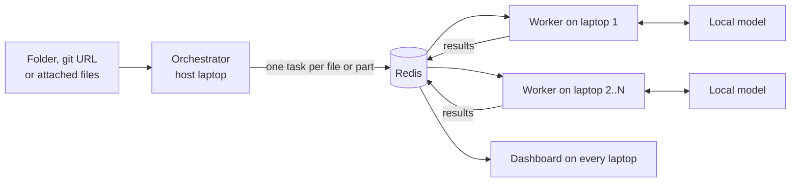

# LapClusters

Turn the laptops your team already owns into one private AI cluster. Every laptop runs its own open model, a shared queue splits the work between them, and nothing is sent to a cloud service.

## How it works

Each laptop runs a local copy of Gemma 4 through Ollama (or llama.cpp). One laptop hosts a Redis queue. A job is split into small tasks — one per file, or per part of a long file — and each laptop takes a task whenever it is free. The results are combined into one answer, and a dashboard on every laptop shows what each one is doing.



## Features

- **Review code** — find defects in every source file of a folder or git repository, ranked by severity.
- **Ask about files** — ask one question across code, documents, PDFs and images, and get a single combined answer.
- **Prompt** and **Write code** — single requests answered by whichever laptop is free.
- **Dashboard** — host or join a cluster, start and cancel jobs, attach files, and inspect every task's prompt, live reply and result.
- **No IP addresses needed** — laptops find the host on the local network automatically.
- **Switchable models** — each laptop reports its installed models; its owner or the host can switch between them.
- **Handles long files and images** — long files are split into overlapping parts; images stay with the text that refers to them and go only to laptops with a vision-capable model.
- **Tolerates failures** — a laptop that drops out has its task taken over; a laptop that can't run its model hands the task back and pauses; failed tasks can be retried.
- **History and activity log** for every job and cluster event.
- **Works from the terminal** too, without the dashboard.

## Requirements

- Python 3.11+
- Ollama with `gemma4:e4b` pulled, or a running llama.cpp server
- Docker (host laptop only, to run Redis)

## Installation

```bash
git clone https://github.com/VishnuVardhanNk/LapCluster.git
cd LapCluster
python -m venv .venv
source .venv/bin/activate        # Windows: .venv\Scripts\Activate.ps1
python -m pip install -r requirements.txt
ollama pull gemma4:e4b
```

On the host laptop, start Redis with a password:

```bash
docker run -d --name redis -p 6379:6379 redis:7 redis-server --requirepass YOUR_PASSWORD
```

The host's firewall must allow inbound TCP 6379 (Redis) and UDP 47600 (discovery).

See [docs/SETUP.md](docs/SETUP.md) for a step-by-step guide.

## Usage

Start the app (opens at `http://127.0.0.1:8470`):

```bash
python -m lapclusters
```

Enter the cluster password (the Redis password), then choose **Host** on the laptop running Redis or **Join** on every other laptop.

From the host's **Work** tab, pick a job type, enter a folder, git URL or question (or attach files), and start it. Click any task to watch its reply as it's written. **Results** shows findings or the combined answer and can be downloaded; **History** and **Activity** record past jobs and cluster events.

Two examples are included:

- `tests/fixtures/sample_repo` — a small repo with planted bugs, for Review code.
- `examples/sales-pack` — a report, chart, PDF and photo, for Ask about files.

### From a terminal

On the host:

```bash
python -m lapclusters.host
python -m lapclusters.worker
```

On other laptops, set `REDIS_URL=redis://:PASSWORD@auto:6379/0` in `.env` and run `python -m lapclusters.worker`.

Then start jobs from the host:

```bash
python -m lapclusters.orchestrator tests/fixtures/sample_repo
python -m lapclusters.orchestrator examples/sales-pack --ask "What does each file say?"
python -m lapclusters.orchestrator --prompt "Explain what a task queue is in one sentence."
python -m lapclusters.orchestrator --code "A Python function that parses an ISO date"
python -m lapclusters.orchestrator tests/fixtures/sample_repo --model gemma4:e2b
```

`python -m lapclusters.discovery` lists visible hosts. If your network blocks broadcasts, replace `auto` with the host's IP address.

## Configuration

No settings are required. To change defaults, copy `.env.example` to `.env`:

```env
REDIS_URL=redis://localhost:6379/0
CLUSTER_HOST=
MODEL_PROVIDER=ollama          # or llama_cpp
OLLAMA_URL=http://localhost:11434
LLAMA_CPP_URL=http://localhost:9931
MODEL=gemma4:e4b
WORKER_NAME=
MODEL_TIMEOUT_S=600
MODEL_CONTEXT=32768
PART_CHARS=48000
```

`MODEL_CONTEXT` is the token limit per request; 32768 fits Gemma 4 E4B on an 8 GB GPU. The host's value is used across the whole cluster. Lower it along with `PART_CHARS` on weaker laptops.

## Project structure

| Path | Purpose |
| --- | --- |
| `lapclusters/taskqueue.py` | Redis task queue (the only module that talks to Redis) |
| `lapclusters/repo.py` | Turns folders or git URLs into tasks; splits long files, extracts PDFs and images |
| `lapclusters/orchestrator.py` | Starts jobs and queues the combining step |
| `lapclusters/worker.py` | Claims tasks, runs them on the model, stores results |
| `lapclusters/llm.py` | Calls the local Ollama or llama.cpp server |
| `lapclusters/review.py`, `ask.py` | Prompts for code review and questions |
| `lapclusters/discovery.py`, `host.py` | Automatic host discovery on the local network |
| `lapclusters/app/` | Dashboard web app |
| `lapclusters/cli.py` | Send a single prompt from a terminal |
| `lapclusters/config.py` | Settings from environment or `.env` |

## Tests

Redis must be running. Tests use Redis database 15.

```bash
python -m pytest
```

## Known limitations

- Tested on two laptops so far.
- The llama.cpp backend is less tested than Ollama: no JSON-schema output (so reviews fail more often) and no image tasks.
- All laptops must run the same version; outdated laptops get no work.
- Discovery needs a network that allows broadcasts. It also trusts whoever answers, so on untrusted networks use a fixed address or a private network like Tailscale.
- Each file or part is examined on its own, so issues spanning files aren't found.
- The model can report problems that aren't real — treat reviews as leads.
- Scanned PDFs (no extractable text) are skipped.

## License

Apache License 2.0. See [LICENSE](LICENSE).

Built with Gemma 4, Ollama, llama.cpp, Redis, FastAPI, uvicorn, redis-py, httpx, pypdf, Pillow, python-dotenv and pytest.
